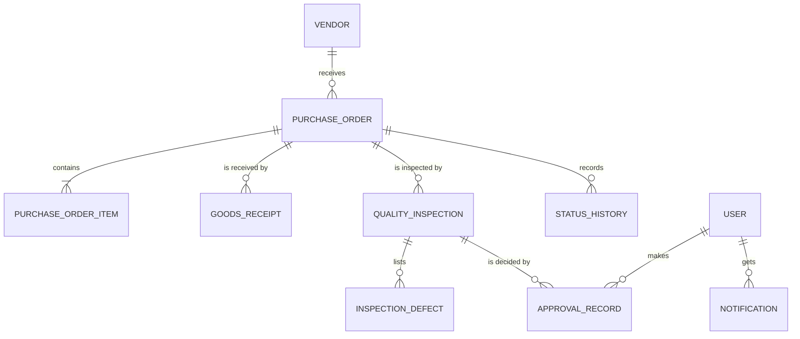

# Architecture and folder structure

## Folder structure

```
SupplyTrust/
├── README.md
├── docs/
│   ├── personas.md            Persona cards and permission matrix
│   ├── user-journeys.md       Journey, sequence and state diagrams
│   ├── wireframes.md          Index of the twelve wireframes
│   ├── architecture.md        This file
│   ├── assets/                Logo
│   ├── screenshots/           Built-screen screenshots (phone, tablet, laptop, intro)
│   └── wireframes/            SVG wireframes
└── app/                       React + Vite + TypeScript application
    ├── index.html
    ├── vite.config.ts         Vite, Tailwind and Vitest configuration
    ├── public/                Favicon
    └── src/
        ├── main.tsx           Entry point
        ├── App.tsx            Providers, routes and the intro screen
        ├── index.css          Tailwind import, theme tokens, intro animations
        ├── types.ts           Domain interfaces (Vendor, PurchaseOrder, QualityInspection, ...)
        ├── components/        Reusable UI components (+ component tests)
        ├── pages/             One file per screen
        ├── state/             React Context: data, current user, toasts, intro
        ├── lib/               Pure logic: derived values, permissions
        ├── data/              Sample dataset
        └── test/              Test setup
```

## Layers

| Layer | Responsibility | Where |
|---|---|---|
| Presentation | Reusable, accessible components | `components/` |
| Screens | Compose components, read state | `pages/` |
| State | Shared data, current demo user, notifications | `state/AppContext.tsx` |
| Domain logic | Totals, delays, rates, permissions - pure functions, unit-tested | `lib/` |
| Data | Typed sample dataset, persisted to LocalStorage | `data/`, `types.ts` |

## Data model



Derived values (order total, outstanding quantity, delay, acceptance and rejection rate) are calculated from the underlying records in `lib/derived.ts`, never stored as editable fields.

## Workflow rules

1. A purchase order needs at least one valid item.
2. Quantities are positive integers; unit prices are zero or more.
3. Received quantities are reconciled against ordered quantities.
4. Accepted + rejected quantity = inspected quantity for a completed inspection.
5. Only authorised roles may approve or reject inspection outcomes.
6. A failed inspection never marks the whole order as accepted.
7. Reinspection preserves all earlier inspection records.
8. Cancelled orders accept no further fulfilment updates.
9. Every important status change records actor, timestamp and previous/new status.
10. In the extended version the backend enforces roles; hiding buttons is not security.

## Technology versions

| Tool | Version |
|---|---|
| Node.js | 24 |
| React / React DOM | 19 |
| TypeScript | 7 |
| Vite | 8 |
| Tailwind CSS | 4 |
| react-router-dom | 7 |
| React Hook Form / Zod | 7 / 4 |
| Chart.js | 4 |
| Vitest / Testing Library | 5 / 16 |

Exact versions are pinned in [`app/package.json`](../app/package.json) and `package-lock.json`.

## Sample dataset

Seven demo users and four vendors (one inactive). Eight purchase orders cover every case the PRD asks for: normal (`PO-2026-006` Approved), delayed (`PO-2026-003`, `PO-2026-002`), partially received (`PO-2026-002`, `PO-2026-008`), rejected inspection (`PO-2026-002`), completed (`PO-2026-001`), draft, pending approval and cancelled. Receipts, inspections, defects, an approval record and status history are included.

## Known limitations

- Data lives in the browser's LocalStorage, so it is per-browser and not shared between users.
- Roles are enforced in the interface only; real multi-user security needs the planned Node.js backend.
- The Week 2 to Week 4 screens are placeholders until built.
