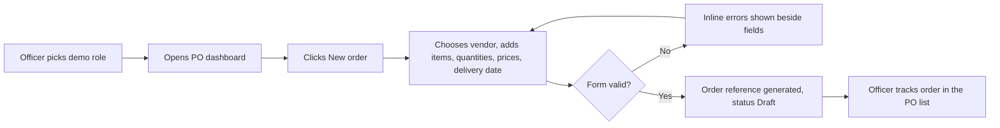
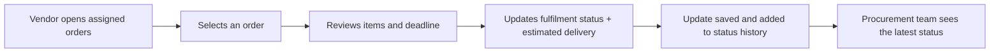
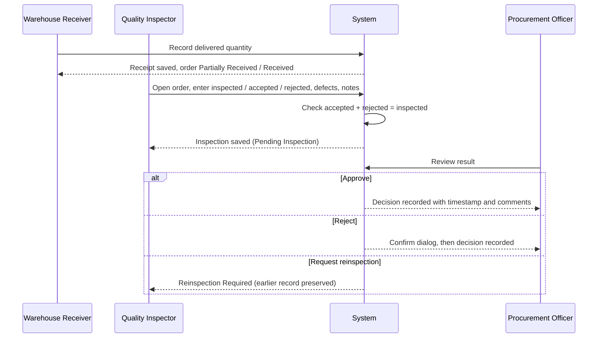
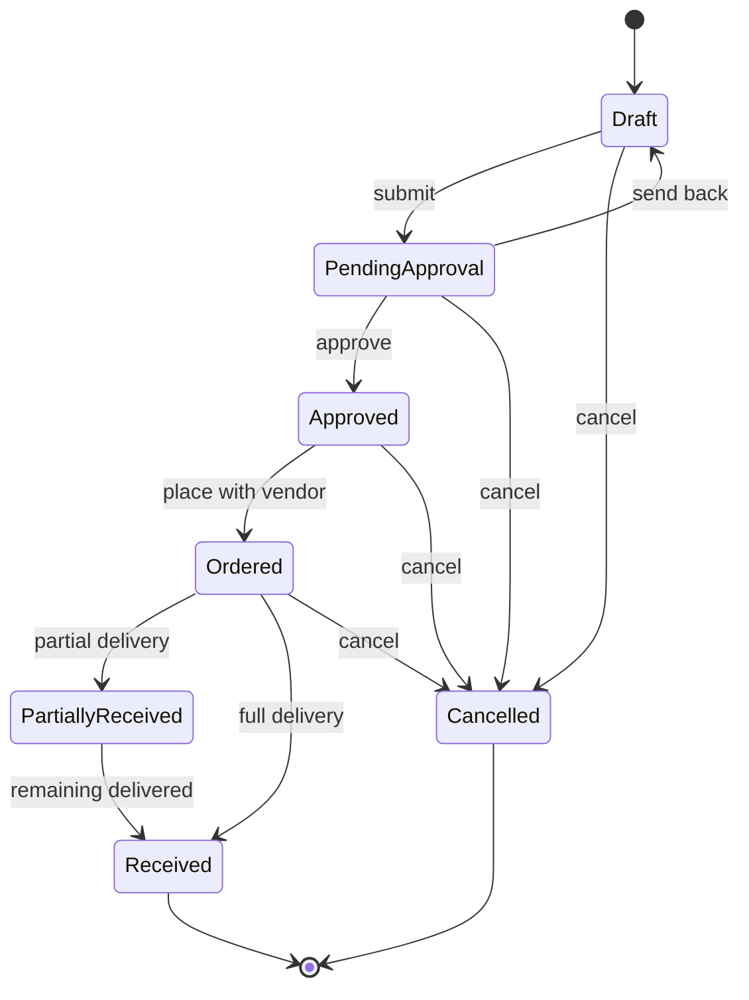
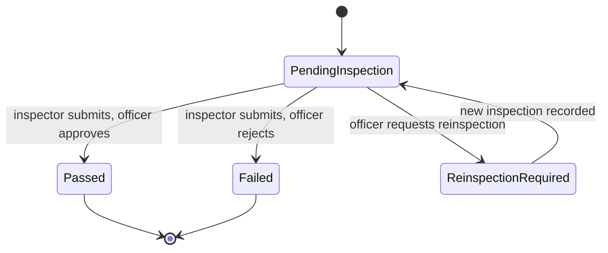

# User journeys and workflow diagrams

The diagrams below render directly on GitHub.

## Journey 1 - Create and manage a purchase order

## Journey 2 - Vendor updates an order

## Journey 3 - Receipt, inspection and approval

## Purchase order status flow

`PendingApproval` is shown as "Pending Approval" and `PartiallyReceived` as "Partially Received" in the interface. Every transition records the actor, timestamp and previous/new status. Cancelled orders accept no further fulfilment updates.

## Inspection outcome flow

A failed inspection never marks the whole order as accepted, and reinspection keeps all previous inspection records.
