# Wireframes

Low-fidelity wireframes for all twelve screens in the screen inventory. The SVG sources are in [`docs/wireframes/`](./wireframes/).

| | |
|---|---|
| 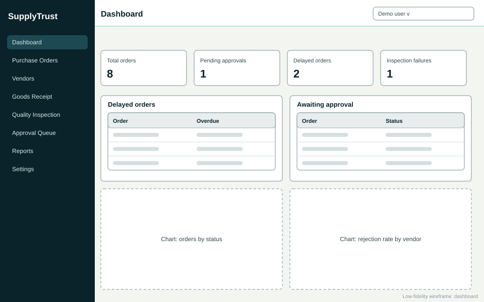 | 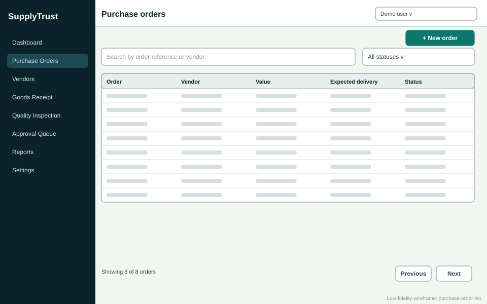 |
| **1. Dashboard** - KPI cards, delayed orders, pending approvals, charts | **2. Purchase order list** - search, status filter, sorting, pagination |
| 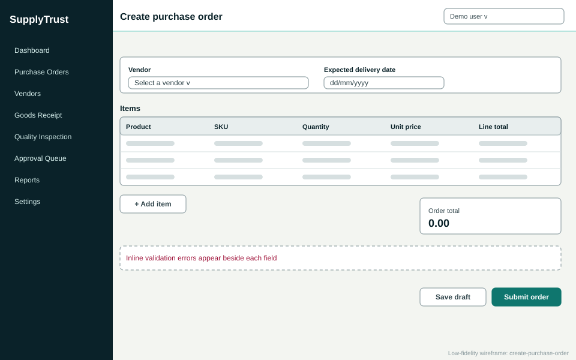 | 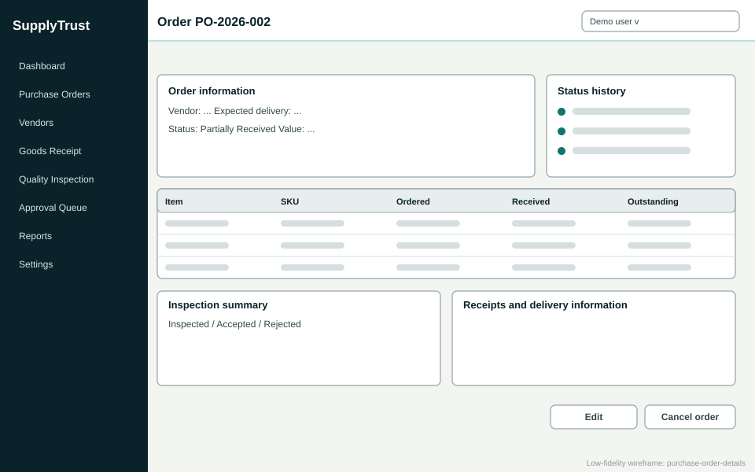 |
| **3. Create purchase order** - vendor, item rows, validation | **4. Order details** - items, totals, timeline, inspection summary |
| 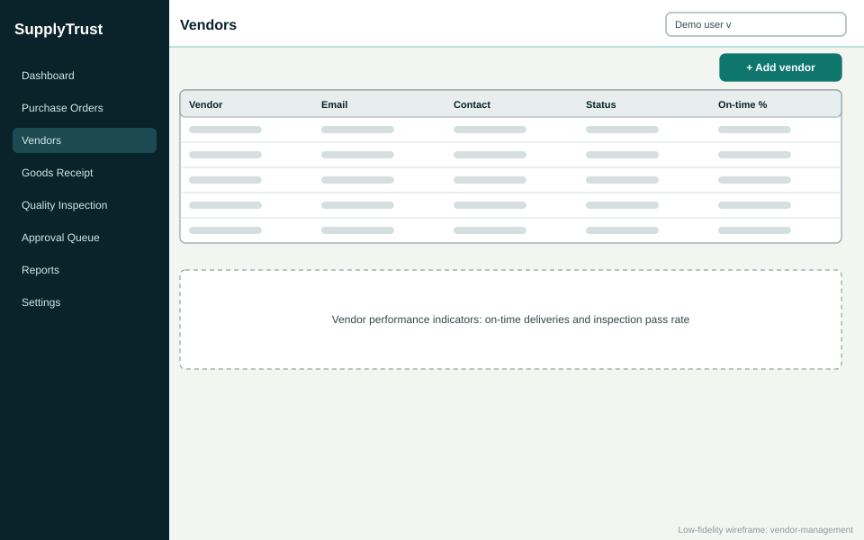 | 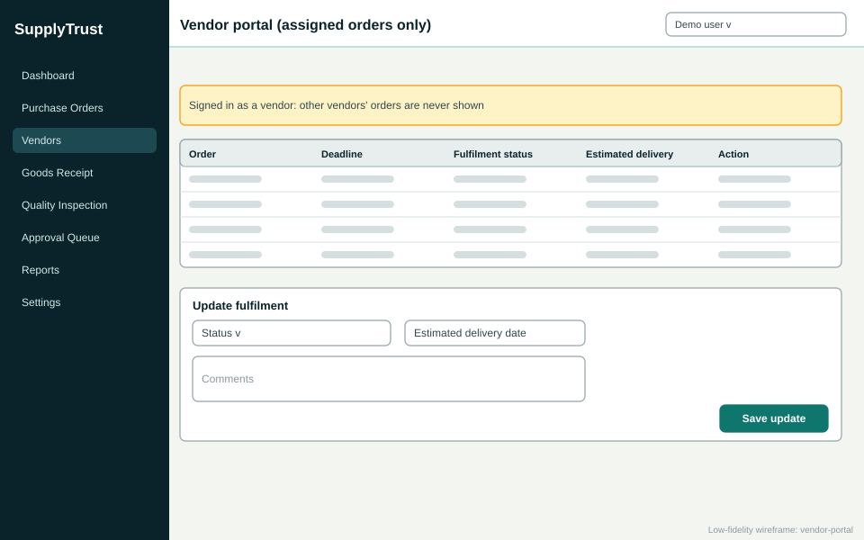 |
| **5. Vendor management** | **6. Vendor portal** - assigned orders only |
| 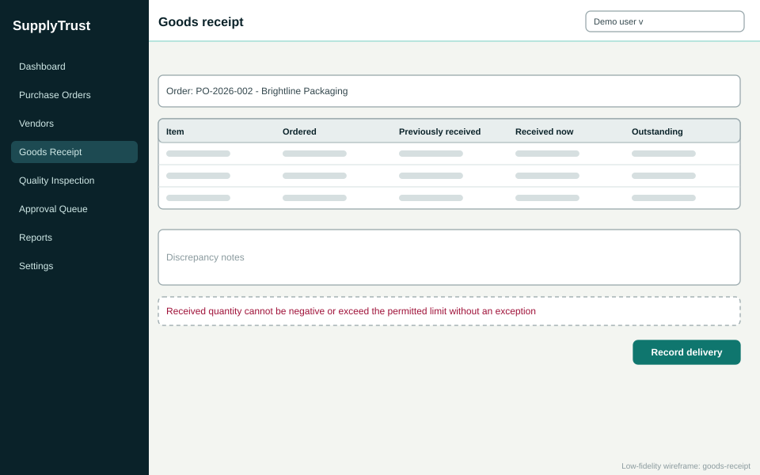 | 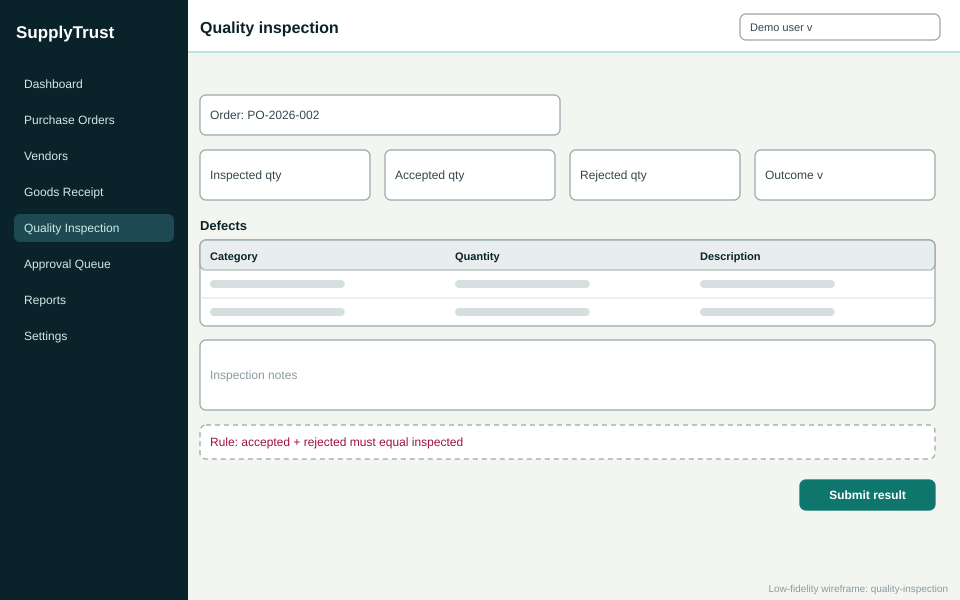 |
| **7. Goods receipt** | **8. Quality inspection** |
| 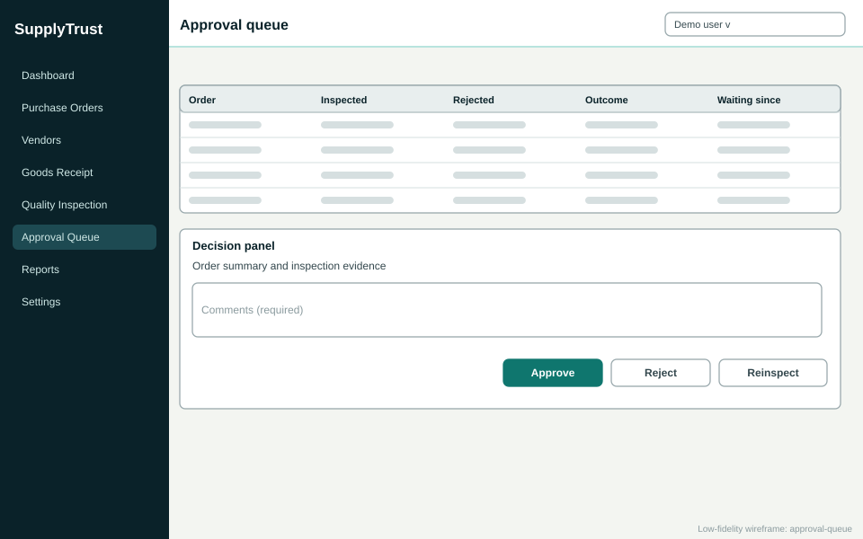 | 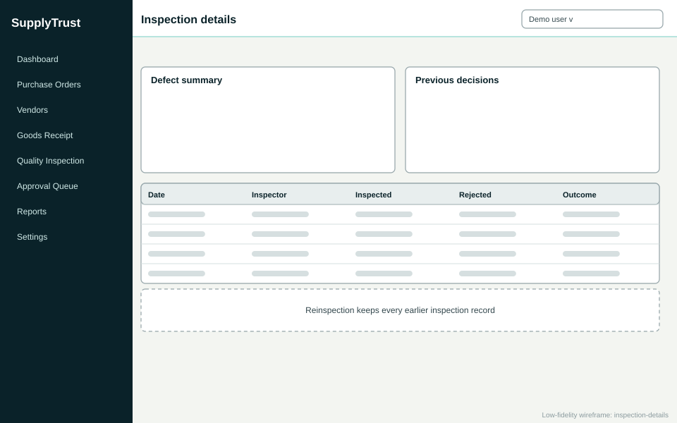 |
| **9. Approval queue** | **10. Inspection details** |
| 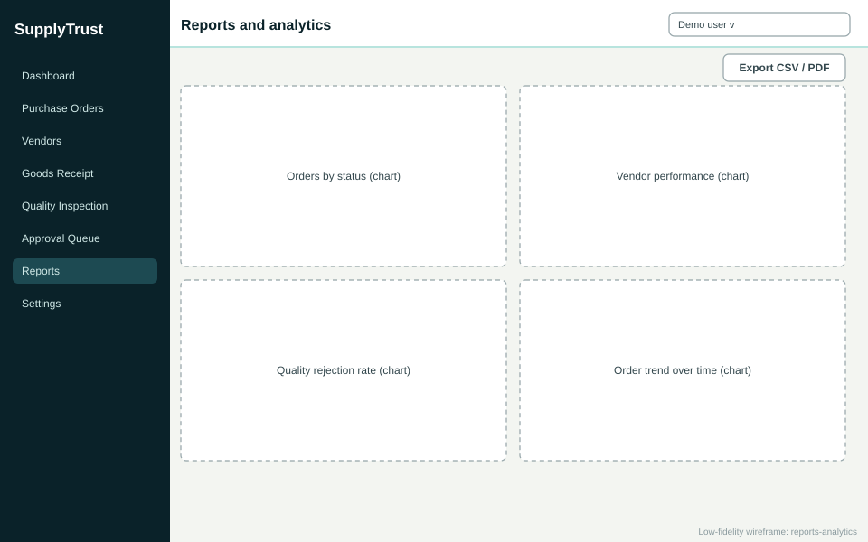 | 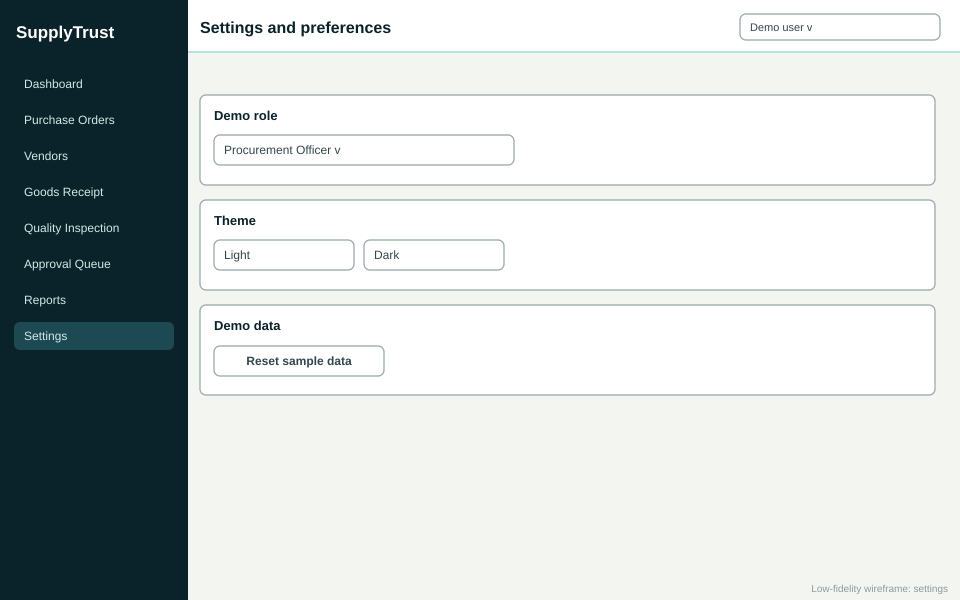 |
| **11. Reports and analytics** | **12. Settings and preferences** |

## Responsive behaviour

| Device | Layout |
|---|---|
| Phone (about 390 px) | Single-column cards, collapsible navigation, order list becomes cards |
| Tablet (about 768 px) | Two-column dashboard, responsive tables |
| Laptop (about 1366 px) | Sidebar, dashboard grid, detailed tables and panels |
| Large display | Expanded analytics and side-by-side detail panels |

Screenshots of the built screens at each size are in [`docs/screenshots/`](./screenshots/).
